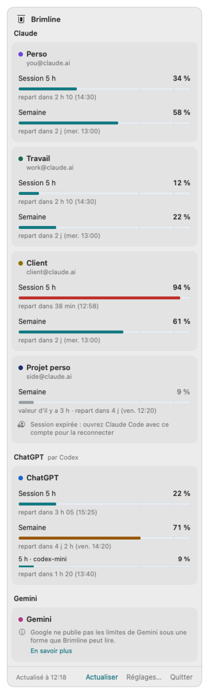
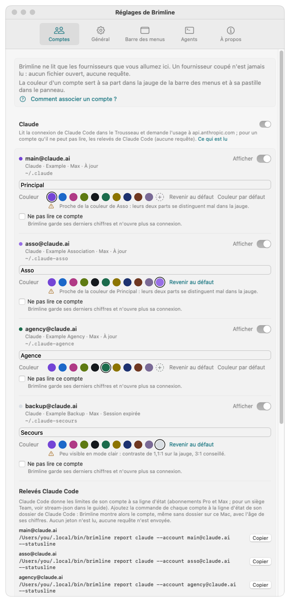

# Brimline

[](LICENSE)
[](#installer)
[](CHANGELOG.md)

*[English version](README.md)*

**Brimline montre, dans la barre des menus du Mac, où en est chaque limite de tes abonnements IA : compte par compte, chacun nommé par son adresse.**

Avec plusieurs comptes Claude (ou Claude et ChatGPT, Gemini, Grok, Cursor), les indicateurs intégrés montrent un compte à la fois, sans dire lequel. Brimline les met côte à côte : limite de session de 5 heures, limite de la semaine, limite de la semaine par modèle, et l'heure où chacune repart.

```bash
curl -fsSL https://brimline.thanaelfontaine.eu/install.sh | sh
```

**Une app Mac seulement :** macOS 14 (Sonoma) ou plus récent, puce Apple ou Intel. Il n'existe pas de version Windows ni Linux. Les autres façons d'installer : [plus bas](#installer).

<p align="center">
  
  
</p>

Les mêmes chiffres sont lisibles par tes agents (une commande à sortie JSON et un serveur MCP local) : un agent peut choisir le compte qui a encore de la marge.

**Beaucoup d'apps d'IA, beaucoup d'icônes ?** Claude, ChatGPT, Cursor et les autres mettent chacun une icône dans la barre des menus. Brimline la dégage aussi : il peut cacher ces icônes derrière un petit trait à lui, et un clic sur la flèche « les fait revenir ([comment](#utiliser)).

<p align="center">
  
</p>

> **État :** privé, rien n'est annoncé : le dépôt et le site ne sont pas encore publics, donc la ligne d'installation et les liens de téléchargement ci-dessus et ci-dessous ne marchent qu'une fois publics. La version actuelle est la 0.2.2. Elle fonctionne avec Claude (par Claude Code, avec plusieurs comptes) et ajoute ChatGPT (par Codex), Gemini (par Antigravity), Grok et Cursor, chacun essayé sur un vrai compte le 27 octobre 2026 : le tableau [plus bas](#fournisseurs) dit sur quel forfait et avec quel résultat. Le [CHANGELOG](CHANGELOG.md) dit ce qui existe.

Le *brim* est le bord jusqu'où monte une cuve, et la *line* la limite tracée au-dessus : Brimline montre d'un coup d'œil à quelle distance du bord tu en es.

*Anciennement Sightglass : renommé le 26 octobre 2026, avant sa première publication (la raison est dans le [CHANGELOG](CHANGELOG.md)).*

## Comment ça marche

1. **Il trouve tes comptes.** Chaque compte Claude est un dossier Claude Code sur ton Mac (`~/.claude`, `~/.claude-work`, ...), connecté une fois avec `/login` : Brimline les liste seul. ChatGPT, Gemini, Grok et Cursor se lisent par leurs propres outils officiels, une fois allumés dans les Réglages.
2. **Il lit, n'écrit jamais.** Brimline se sert de la connexion que ces outils gardent déjà et demande à chaque fournisseur ta consommation, la même requête que l'outil officiel. Il ne te connecte jamais, ne renouvelle ni ne copie aucun jeton, et n'envoie rien ailleurs.
3. **Il résume tout dans la barre des menus.** Une jauge, une part colorée par compte, et un « ! » rouge dès qu'un compte atteint 90 %. Clique dessus pour la fenêtre : une carte par compte, une barre par limite, et l'heure où elle repart.
4. **Tes agents peuvent demander aussi.** `brimline status --json` et un serveur MCP local (`best_account`) permettent à un agent de choisir le compte qui a encore de la marge.
5. **Il peut cacher les icônes des autres apps.** Allume « Cacher sans retirer » (Réglages, Barre des menus, coupé par défaut) : les icônes placées à gauche du trait de Brimline se cachent et reviennent d'un clic.

## Installer

Brimline est une **app Mac seulement** : macOS 14 (Sonoma) ou plus récent, sur puce Apple ou Intel (une seule app universelle ; essayée sur puce Apple seulement pour l'instant). Il n'existe pas de version Windows ni Linux.

**En une ligne**, dans le Terminal :

```bash
curl -fsSL https://brimline.thanaelfontaine.eu/install.sh | sh
```

Le script ([à lire d'abord](https://brimline.thanaelfontaine.eu/install.sh) si tu veux) télécharge la dernière version depuis GitHub, la vérifie avec son SHA-256 publié, met `Brimline.app` dans `/Applications` (ou là où Brimline est déjà, ou `~/Applications` quand `/Applications` n'est pas modifiable), relie la commande `brimline` à `~/.local/bin/brimline` et ouvre l'app. Aucun mot de passe administrateur, rien d'écrit ailleurs. La même ligne, relancée, met à jour.

**Ou l'image disque :** télécharge [Brimline.dmg](https://github.com/ThanaelFontaine/Brimline/releases/latest/download/Brimline.dmg) (son SHA-256 est [à côté](https://github.com/ThanaelFontaine/Brimline/releases/latest)), ouvre-la et glisse Brimline sur Applications. Brimline n'est pas notarisé par Apple (il faudrait un compte Apple Developer payant) : macOS le bloque la première fois que tu l'ouvres. Ferme le message, puis va dans **Réglages Système, Confidentialité et sécurité** et clique sur **Ouvrir quand même**, puis **Ouvrir** ([la page d'Apple](https://support.apple.com/fr-fr/102445)). macOS ne le demande qu'une fois.

**Ou depuis la source**, avec les Command Line Tools d'Apple (ni Xcode, ni compte Apple) :

```bash
git clone https://github.com/ThanaelFontaine/Brimline.git
cd Brimline
scripts/build_app.sh     # construit build/Brimline.app
scripts/install.sh       # la copie dans /Applications (ou ~/Applications), relie la commande, ouvre l'app
```

Brimline vit ensuite dans la barre des menus, pas dans le Dock : cherche sa jauge en haut à droite de l'écran. Prérequis, ce que montre macOS, mise à jour et désinstallation : [docs/install.md](docs/install.md) (en anglais).

## Principes

- **Lecture seule.** Brimline lit les jetons de connexion que tes outils IA rangent déjà sur le Mac (pour Claude Code, le Trousseau de macOS ; pour Codex, Grok et Cursor, un fichier que chacun garde). Il ne les renouvelle, ne les réécrit et ne les déplace jamais : il ne peut donc jamais te déconnecter d'un outil. Un jeton expiré s'affiche « Session expirée », il ne se répare pas en douce. **Une exception, dite en toutes lettres :** pour lire Gemini, Brimline lance la commande de Google `agy --print /usage`, et le programme de Google peut alors renouveler lui-même sa connexion ; Brimline ne lit ni n'écrit cette connexion (voir [SECURITY.md](SECURITY.md), en anglais).
- **Coupé tant que tu ne l'allumes pas.** Claude est allumé ; tout autre fournisseur est coupé jusqu'à ce que tu l'allumes dans les réglages (ou avec `brimline providers enable <nom>`), et un fournisseur coupé n'est pas touché du tout. Un compte marqué « Ne pas lire ce compte » n'est jamais lu non plus.
- **Rien ne sort du Mac**, hormis les requêtes d'usage vers chaque fournisseur. Aucun serveur, aucune télémétrie, aucun jeton dans un journal.
- **Un compte, une ligne, une adresse.** Plusieurs comptes par fournisseur, c'est le cas normal.
- **Ouvert à tout fournisseur.** Chaque fournisseur est un petit greffon : Claude, ChatGPT (Codex), Gemini (Antigravity), Grok et Cursor pour l'instant.
- **Honnête sur la fragilité.** À notre connaissance (octobre 2026), aucun fournisseur ne documente de point d'accès pour les limites d'un abonnement (Google documente une commande, `/usage` dans Antigravity, mais pas le format de son texte). Brimline passe par les mêmes points d'accès internes que les outils officiels, qui peuvent changer sans préavis. Quand l'un casse, Brimline le dit au lieu d'afficher un faux chiffre. Et il dit ce qu'il a essayé : un fournisseur n'est « lu et vérifié » que pour le forfait sur lequel il a été essayé (section suivante).

Pourquoi un outil de plus, quand de bons existent (CodexBar, ClaudeBar, Claude Usage Tracker) ? Voir [docs/why.md](docs/why.md) (en anglais).

## Fournisseurs

<p align="center">
  
</p>

Chaque nouveau fournisseur a été essayé le **27 octobre 2026** sur le compte de l'auteur, **sur le seul forfait du tableau**. Rien n'est affirmé pour un forfait qui n'a pas été essayé, un forfait payant surtout. Les chiffres des images sont inventés.

| Fournisseur | Lu par | Source | Forfait essayé (27/10/2026) | État |
|---|---|---|---|---|
| Claude | Connexion de Claude Code (Trousseau) ; pour un compte qu'il ne peut pas lire, les [relevés de Claude Code](docs/accounts.fr.md#relevés-de-claude-code--un-compte-que-brimline-ne-lit-pas-directement) | Non documentée (les relevés : ligne d'état documentée) | Vrais comptes, depuis la v0.1.0 | Lu et vérifié |
| ChatGPT | Codex (`~/.codex/auth.json`) | Non documentée (code public de Codex) | ChatGPT gratuit : le mois, 0 % | Lu et vérifié sur ce forfait ; comparaison avec la page d'usage d'OpenAI en attente |
| Gemini | Antigravity CLI (`agy --print /usage`) | Commande documentée, format du texte non | Un compte Google (`agy` ne dit pas le forfait) : cinq limites, aucune entamée | Lu et vérifié, sauf que le pourcentage n'a été vu qu'à 100 % restant, et que la référence est le texte d'`agy` lui-même |
| Grok | CLI Grok (`~/.grok/auth.json`) | Non documentée (code public du CLI) | Un compte gratuit : **xAI ne renvoie aucune limite, donc aucun pourcentage n'est affiché** | Lu et vérifié pour cette seule phrase ; xAI n'a pas de page de comparaison |
| Cursor | Connexion de l'app Cursor (sa base d'état) | Non documentée (code public de CodexBar) | Cursor Free : le mois, Auto et API, 0 % | Lu et vérifié sur ce forfait ; comparaison avec la page d'usage de cursor.com en attente |

Ce qui est lu exactement, d'où vient la source et ce que chaque essai a montré : [docs/providers.md](docs/providers.md) (en anglais).

## Utiliser

- **Associe tes comptes.** Un dossier Claude Code par compte Claude, choisi avec `CLAUDE_CONFIG_DIR` et connecté une fois avec `/login` ; Brimline les trouve seul. Les autres fournisseurs : allume-les dans Réglages, Comptes. Pas à pas : [docs/accounts.fr.md](docs/accounts.fr.md).
- **Lis la barre des menus.** Le glyphe se couche et devient une jauge : une part colorée par compte (sa limite la plus serrée), donc la jauge entière est leur moyenne. Dès qu'un compte atteint 90 %, le trait de la limite devient un « ! » rouge (une forme, pas seulement une couleur). L'infobulle et VoiceOver le disent en mots.
- **Ouvre la fenêtre.** Les cartes regroupées par fournisseur, une jauge par limite avec son pourcentage et son heure de remise à zéro (« repart dans 2 h 10 (14:30) »). Un fournisseur qui ne donne aucune limite lisible le dit en une phrase, jamais avec un chiffre inventé.
- **Réglages** (depuis la fenêtre, ou en rouvrant l'app) : masquer un compte ou lui donner un libellé, choisir sa couleur, allumer ou couper chaque fournisseur, marquer un compte « Ne pas lire ce compte », changer l'intervalle d'actualisation (2 à 15 minutes), afficher le pourcentage à côté de la jauge, ouvrir à la connexion.
- **Cache les icônes des autres apps** (coupé par défaut, Réglages, Barre des menus, « Cacher sans retirer »). Brimline ajoute un petit trait à lui dans la barre des menus. Une fois, maintiens Cmd et glisse les icônes à cacher (Claude, ChatGPT, Cursor...) à sa gauche. Ensuite un clic sur le trait, ou « Cacher les icônes » dans la fenêtre, les cache : sous macOS 27, elles partent l'une après l'autre vers le trait, qui devient une flèche « ; un clic sur la flèche les fait revenir. Quitter Brimline ou couper le réglage montre à nouveau toutes les icônes. Sous macOS 27, il utilise une API privée de macOS et l'autorisation Accessibilité, seulement pour lire où sont les icônes, et Brimline doit être dans `/Applications` ; sous macOS 26 et avant, son trait s'allonge pour pousser les icônes hors de vue. Le même onglet dit aussi où couper l'icône de chaque app. Détail et limites : [docs/menu-bar.fr.md](docs/menu-bar.fr.md).

  

L'app suit la langue du Mac (anglais ou français). Chaque état est dit en mots, jamais par la seule couleur :

<p align="center">
  
  
</p>

<p align="center">
  
  
  
</p>

## Pour les agents

```bash
brimline status --json                                              # chaque compte, chaque limite, avec l'âge des données
claude mcp add --scope user brimline -- ~/.local/bin/brimline mcp   # outils MCP : list_accounts, get_usage, best_account
brimline status --provider chatgpt --json                           # un seul fournisseur (claude, chatgpt, gemini, grok, cursor)
```

Les trois lisent le cache écrit par l'app et ne voient jamais de jeton (seule `brimline status --live` lit le Trousseau, comme l'app). Détails et format JSON : [docs/agents.md](docs/agents.md) (en anglais).

## Les conditions d'Anthropic

Brimline est un projet indépendant : ni fait, ni approuvé, ni soutenu par Anthropic. La documentation d'Anthropic ([Legal and compliance, Authentication and credential use](https://code.claude.com/docs/en/legal-and-compliance), en anglais) dit que les connexions OAuth sont prévues pour Claude Code et les applications d'Anthropic, et que les développeurs tiers ne peuvent pas proposer la connexion Claude.ai dans leurs applications, faire passer des requêtes par les identifiants d'un abonnement Free, Pro ou Max pour le compte de leurs utilisateurs, ni collecter, stocker ou relayer des identifiants ou jetons de session Claude.ai.

Ce que fait Brimline, pour que tu juges toi-même : il tourne sur ton propre Mac et lit la connexion que Claude Code y a déjà rangée, en lecture seule. Il ne te connecte jamais, n'écrit, ne renouvelle ni ne copie le jeton, et ne l'envoie qu'à Anthropic, pour demander tes propres chiffres d'usage, sous son propre nom (`User-Agent: Brimline/<version>`). Il n'envoie aucune requête à un modèle. Nous ne prétendons pas qu'Anthropic autorise cet usage : lis les conditions de ton abonnement et décide. La même page dit qu'Anthropic peut faire respecter ces restrictions sans préavis : le risque éventuel porte sur le compte que Brimline lit.

## Documentation

- [Associer vos comptes](docs/accounts.fr.md) ([in English](docs/accounts.md))
- [Fournisseurs : ce qui est lu, d'où, ce qui a été essayé](docs/providers.md) (en anglais)
- [Installer](docs/install.md) (en anglais)
- [Agents : commande et serveur MCP](docs/agents.md) (en anglais)
- [FAQ](docs/faq.md) (en anglais)
- [Pourquoi Brimline](docs/why.md) (en anglais)
- [Modèle de sécurité](SECURITY.md) (en anglais)
- [Direction artistique : couleurs, glyphe, icône](design/DA.md)

## Licence

Code source public sous licence [PolyForm Shield 1.0.0](LICENSE), © 2026 Thanaël Fontaine : ce n'est pas de l'open source au sens de l'OSI. Chacun peut l'utiliser, le modifier et le partager, y compris au travail ou pour vendre ses propres produits et services ; personne ne peut en faire un produit concurrent, même gratuit (le revendre, le proposer en service hébergé). L'auteur garde tous ses droits, dont celui de vendre sa propre version hébergée.

Les contributions sont les bienvenues : voir [CONTRIBUTING.md](CONTRIBUTING.md). Signaler une faille : voir [SECURITY.md](SECURITY.md).
