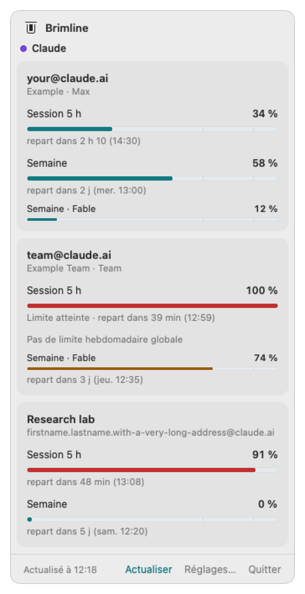
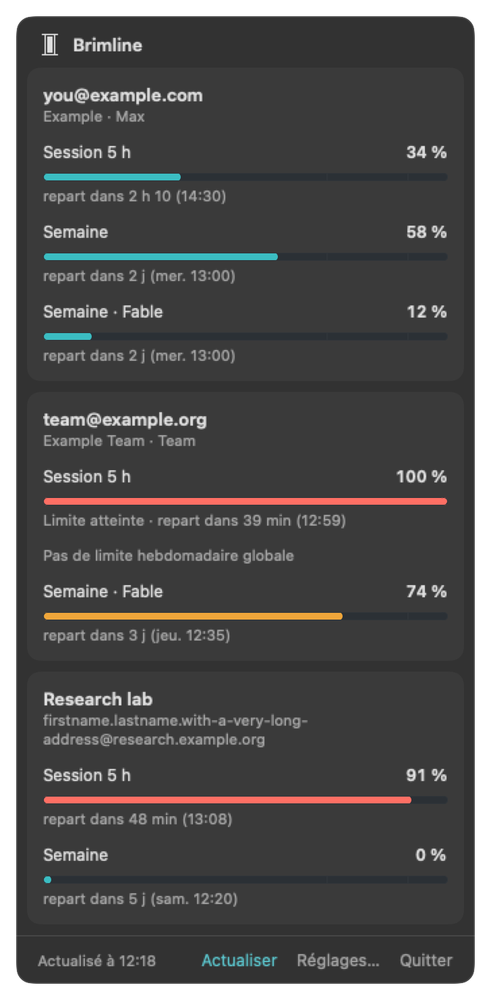
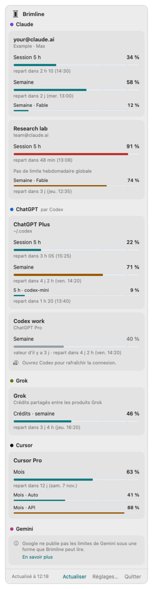
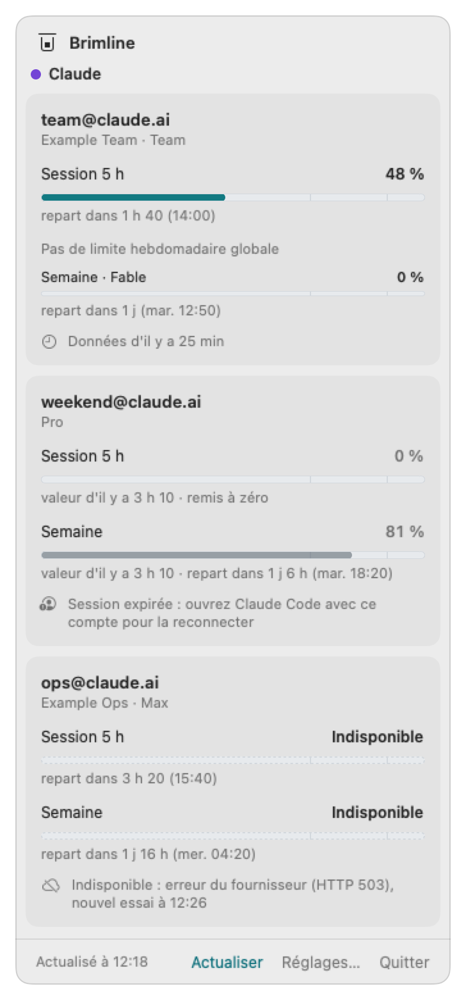
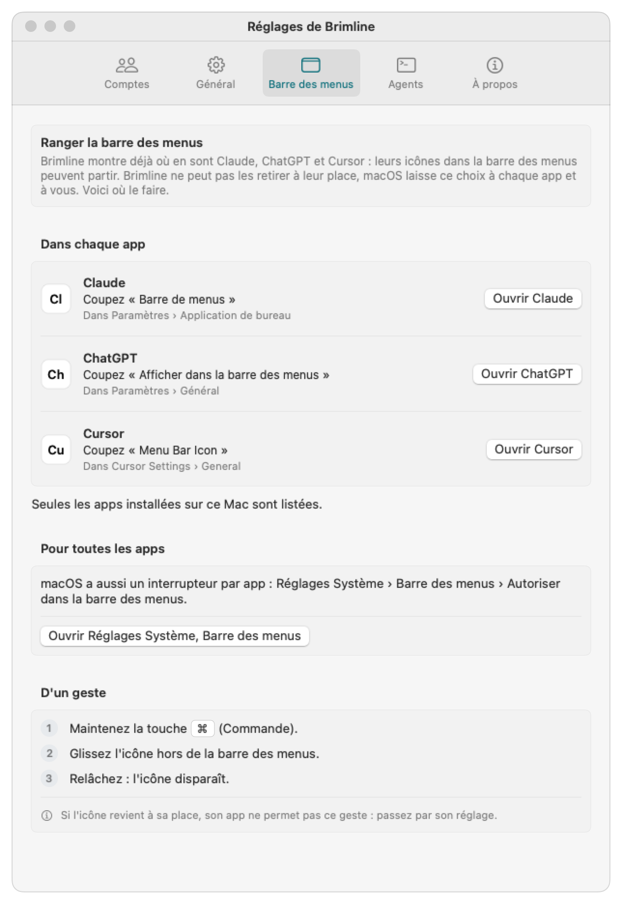

# Brimline

*Anciennement Sightglass. Renommé le 26 octobre 2026, avant la première publication, parce que le nom Sightglass est déjà porté par des logiciels proches (la raison est dans le [CHANGELOG](CHANGELOG.md)).*

[](LICENSE)
[](CHANGELOG.md)

*[English version](README.md)*

**Brimline montre, dans la barre des menus du Mac, où en est chaque limite de tes abonnements IA : compte par compte, chacun nommé par son adresse.**

Avec plusieurs comptes Claude (ou Claude et ChatGPT, Gemini, Grok, Cursor), les indicateurs intégrés montrent un compte à la fois, sans dire lequel. Brimline les met côte à côte : limite de session de 5 heures, limite de la semaine, limite de la semaine par modèle, et l'heure où chacune repart.

<p align="center">
  
  
</p>

Les mêmes chiffres sont lisibles par tes agents (une commande à sortie JSON et un serveur MCP local) : un agent peut choisir le compte qui a encore de la marge.

> **État :** en développement, pas encore publié. La version 0.1 fonctionne avec Claude (par Claude Code). La prochaine, 0.2.0, ajoute ChatGPT (par Codex), Gemini (par Antigravity), Grok et Cursor, chacun essayé sur un vrai compte le 27 octobre 2026 : le tableau [plus bas](#fournisseurs) dit sur quel forfait et avec quel résultat. Le [CHANGELOG](CHANGELOG.md) dit ce qui existe.

Le *brim* est le bord jusqu'où monte une cuve, et la *line* la limite tracée au-dessus : Brimline montre d'un coup d'œil à quelle distance du bord tu en es.

## Principes

- **Lecture seule.** Brimline lit les jetons de connexion que tes outils IA rangent déjà sur le Mac (pour Claude Code, le Trousseau de macOS ; pour Codex, Grok et Cursor, un fichier que chacun garde). Il ne les renouvelle, ne les réécrit et ne les déplace jamais : il ne peut donc jamais te déconnecter d'un outil. Un jeton expiré s'affiche « Session expirée », il ne se répare pas en douce. **Une exception, dite en toutes lettres :** pour lire Gemini, Brimline lance la commande de Google `agy --print /usage`, et le programme de Google peut alors renouveler lui-même sa connexion ; Brimline ne lit ni n'écrit cette connexion (voir [SECURITY.md](SECURITY.md), en anglais).
- **Coupé tant que tu ne l'allumes pas.** Claude est allumé ; tout autre fournisseur est coupé jusqu'à ce que tu l'allumes dans les réglages (ou avec `brimline providers enable <nom>`), et un fournisseur coupé n'est pas touché du tout. Un compte marqué « Ne pas lire ce compte » n'est jamais lu non plus.
- **Rien ne sort du Mac**, hormis les requêtes d'usage vers chaque fournisseur. Aucun serveur, aucune télémétrie, aucun jeton dans un journal.
- **Un compte, une ligne, une adresse.** Plusieurs comptes par fournisseur, c'est le cas normal.
- **Ouvert à tout fournisseur.** Chaque fournisseur est un petit greffon : Claude, ChatGPT (Codex), Gemini (Antigravity), Grok et Cursor pour l'instant.
- **Honnête sur la fragilité.** À notre connaissance (octobre 2026), aucun fournisseur ne documente de point d'accès pour les limites d'un abonnement (Google documente une commande, `/usage` dans Antigravity, mais pas le format de son texte). Brimline passe par les mêmes points d'accès internes que les outils officiels, qui peuvent changer sans préavis. Quand l'un casse, Brimline le dit au lieu d'afficher un faux chiffre. Et il dit ce qu'il a essayé : un fournisseur n'est « lu et vérifié » que pour le forfait sur lequel il a été essayé (section suivante).

Pourquoi un outil de plus, quand de bons existent (CodexBar, ClaudeBar, Claude Usage Tracker) ? Voir [docs/why.md](docs/why.md) (en anglais).

## Fournisseurs

<p align="center">
  
</p>

Chaque nouveau fournisseur a été essayé le **27 octobre 2026** sur le compte de l'auteur, **sur le seul forfait du tableau**. Rien n'est affirmé pour un forfait qui n'a pas été essayé, un forfait payant surtout. Les chiffres des images sont inventés.

| Fournisseur | Lu par | Source | Forfait essayé (27/10/2026) | État |
|---|---|---|---|---|
| Claude | Connexion de Claude Code (Trousseau) | Non documentée | Vrais comptes, depuis la v0.1.0 | Lu et vérifié |
| ChatGPT | Codex (`~/.codex/auth.json`) | Non documentée (code public de Codex) | ChatGPT gratuit : le mois, 0 % | Lu et vérifié sur ce forfait ; comparaison avec la page d'usage d'OpenAI en attente |
| Gemini | Antigravity CLI (`agy --print /usage`) | Commande documentée, format du texte non | Un compte Google (`agy` ne dit pas le forfait) : cinq limites, aucune entamée | Lu et vérifié, sauf que le pourcentage n'a été vu qu'à 100 % restant, et que la référence est le texte d'`agy` lui-même |
| Grok | CLI Grok (`~/.grok/auth.json`) | Non documentée (code public du CLI) | Un compte gratuit : **xAI ne renvoie aucune limite, donc aucun pourcentage n'est affiché** | Lu et vérifié pour cette seule phrase ; xAI n'a pas de page de comparaison |
| Cursor | Connexion de l'app Cursor (sa base d'état) | Non documentée (code public de CodexBar) | Cursor Free : le mois, Auto et API, 0 % | Lu et vérifié sur ce forfait ; comparaison avec la page d'usage de cursor.com en attente |

Ce qui est lu exactement, d'où vient la source et ce que chaque essai a montré : [docs/providers.md](docs/providers.md) (en anglais).

## Installer

Il n'y a pas encore d'app notariée à télécharger : tu construis Brimline sur ton Mac, avec les Command Line Tools d'Apple (ni Xcode, ni compte Apple).

```bash
git clone https://github.com/ThanaelFontaine/Brimline.git
cd Brimline
scripts/build_app.sh     # construit build/Brimline.app
scripts/install.sh       # la copie dans ~/Applications, relie la commande, ouvre l'app
```

Ajoute `--login` à `install.sh` pour ouvrir aussi Brimline à la connexion (ou active-le plus tard dans **Réglages, Général**).

Prérequis, ce que montre macOS, mise à jour et désinstallation : [docs/install.md](docs/install.md) (en anglais).

## Utiliser

1. **Associe tes comptes.** Chaque compte Claude est un dossier de configuration de Claude Code (`~/.claude`, `~/.claude-work`, ...), choisi avec `CLAUDE_CONFIG_DIR` et connecté une fois avec `/login`. Brimline les trouve seul. Pas à pas : [docs/accounts.fr.md](docs/accounts.fr.md).
2. **Clique sur le glyphe dans la barre des menus.** Son niveau suit le compte le plus proche d'une limite. Les cartes sont regroupées par fournisseur (un point et son nom, « ChatGPT par Codex ») ; chaque carte montre son nom, puis une jauge par limite avec son pourcentage et son heure de remise à zéro (« repart dans 2 h 10 (14:30) »), une limite propre à un modèle tenant sur une ligne compacte dessous. Un fournisseur qui ne donne aucune limite lisible par Brimline (Gemini sans Antigravity, ou un compte Grok gratuit : « xAI ne renvoie aucune limite de crédits pour ce compte. ») montre une phrase et pas de jauge ; « En savoir plus » ouvre le reste.
3. **Réglages** (depuis la fenêtre, ou en rouvrant l'app) : masquer un compte, lui donner un libellé, ajouter un dossier Claude Code ou Codex, changer l'intervalle d'actualisation (2 à 15 minutes), afficher le pourcentage à côté du glyphe, ouvrir à la connexion. Chaque fournisseur a son bloc, avec un interrupteur, une ligne qui dit ce que Brimline lit et où il le demande (« Ce qui est lu » ouvre [providers](docs/providers.md)), et une case « Ne pas lire ce compte » par compte : Claude est allumé ; tout autre fournisseur est **coupé tant que tu ne l'allumes pas** (Gemini se lit en lançant la commande d'Antigravity de Google, `agy --print /usage`, le seul programme tiers que Brimline lance, et seule sa build vérifiée le 27/10/2026 (Antigravity CLI 1.4.8) est lancée : voir [providers](docs/providers.md) ; Cursor est lu par la connexion que son app garde, avec une requête à cursor.com : voir [providers](docs/providers.md)), et un fournisseur coupé n'est pas touché du tout (`brimline providers` fait la même chose depuis le terminal).
4. **Ranger la barre des menus** (Réglages, Barre des menus) : Claude, ChatGPT et Cursor posent chacun leur icône dans la barre des menus, et Brimline montre déjà où ils en sont. Brimline **ne peut pas masquer l'icône d'une autre app** : macOS n'offre aucune voie publique pour cela, et les voies non publiques (Accessibilité, Enregistrement de l'écran) sont cassées sous macOS 27 et demandent des autorisations qu'un suivi de consommation ne doit pas réclamer. Cet onglet n'en demande donc aucune : pour chacune des trois apps installées sur le Mac, il nomme l'interrupteur de son icône (« Coupez « Barre de menus » »), dit où il est et ouvre l'app ; il ouvre Réglages Système sur Barre des menus (où macOS a son propre interrupteur « Autoriser dans la barre des menus » par app) ; et il explique le geste Commande + glisser. Il ne lit de ces apps que l'endroit où elles sont installées.

L'app suit la langue du Mac (anglais ou français). Chaque état est dit en mots, jamais par la seule couleur :

<p align="center">
  
  
  
</p>

## Pour les agents

```bash
brimline status --json                                              # chaque compte, chaque limite, avec l'âge des données
claude mcp add --scope user brimline -- ~/.local/bin/brimline mcp   # outils MCP : list_accounts, get_usage, best_account
brimline status --provider chatgpt --json                           # un seul fournisseur (claude, chatgpt, gemini, grok, cursor)
```

Les trois lisent le cache écrit par l'app et ne voient jamais de jeton (seule `brimline status --live` lit le Trousseau, comme l'app). Détails et format JSON : [docs/agents.md](docs/agents.md) (en anglais).

## Les conditions d'Anthropic

Brimline est un projet indépendant : ni fait, ni approuvé, ni soutenu par Anthropic. La documentation d'Anthropic ([Legal and compliance, Authentication and credential use](https://code.claude.com/docs/en/legal-and-compliance), en anglais) dit que les connexions OAuth sont prévues pour Claude Code et les applications d'Anthropic, et que les développeurs tiers ne peuvent pas proposer la connexion Claude.ai dans leurs applications, faire passer des requêtes par les identifiants d'un abonnement Free, Pro ou Max pour le compte de leurs utilisateurs, ni collecter, stocker ou relayer des identifiants ou jetons de session Claude.ai.

Ce que fait Brimline, pour que tu juges toi-même : il tourne sur ton propre Mac et lit la connexion que Claude Code y a déjà rangée, en lecture seule. Il ne te connecte jamais, n'écrit, ne renouvelle ni ne copie le jeton, et ne l'envoie qu'à Anthropic, pour demander tes propres chiffres d'usage, sous son propre nom (`User-Agent: Brimline/<version>`). Il n'envoie aucune requête à un modèle. Nous ne prétendons pas qu'Anthropic autorise cet usage : lis les conditions de ton abonnement et décide. La même page dit qu'Anthropic peut faire respecter ces restrictions sans préavis : le risque éventuel porte sur le compte que Brimline lit.

## Documentation

- [Associer vos comptes](docs/accounts.fr.md) ([in English](docs/accounts.md))
- [Fournisseurs : ce qui est lu, d'où, ce qui a été essayé](docs/providers.md) (en anglais)
- [Installer](docs/install.md) (en anglais)
- [Agents : commande et serveur MCP](docs/agents.md) (en anglais)
- [FAQ](docs/faq.md) (en anglais)
- [Pourquoi Brimline](docs/why.md) (en anglais)
- [Modèle de sécurité](SECURITY.md) (en anglais)
- [Direction artistique : couleurs, glyphe, icône](design/DA.md)

## Licence

Code source public sous licence [PolyForm Shield 1.0.0](LICENSE), © 2026 Thanaël Fontaine : ce n'est pas de l'open source au sens de l'OSI. Chacun peut l'utiliser, le modifier et le partager, y compris au travail ou pour vendre ses propres produits et services ; personne ne peut en faire un produit concurrent, même gratuit (le revendre, le proposer en service hébergé). L'auteur garde tous ses droits, dont celui de vendre sa propre version hébergée.

Les contributions sont les bienvenues : voir [CONTRIBUTING.md](CONTRIBUTING.md). Signaler une faille : voir [SECURITY.md](SECURITY.md).
