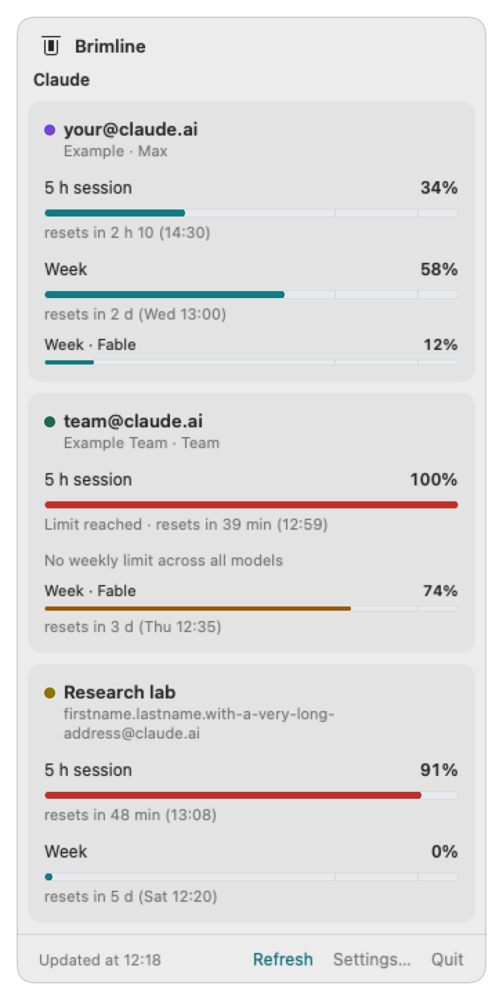
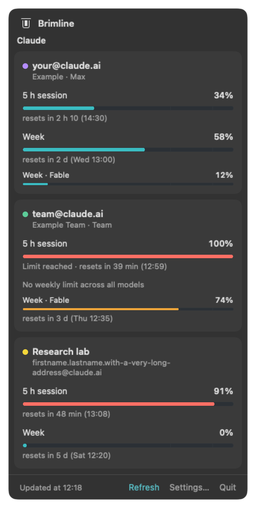
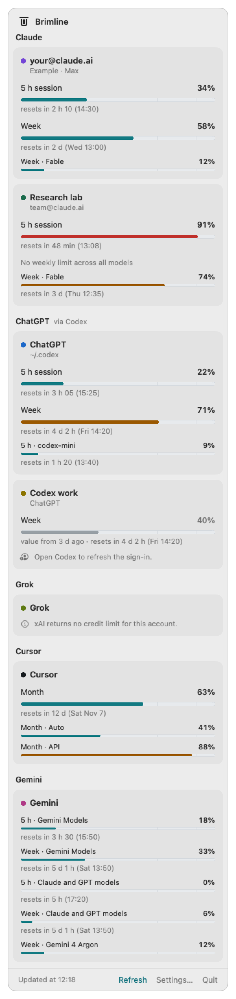
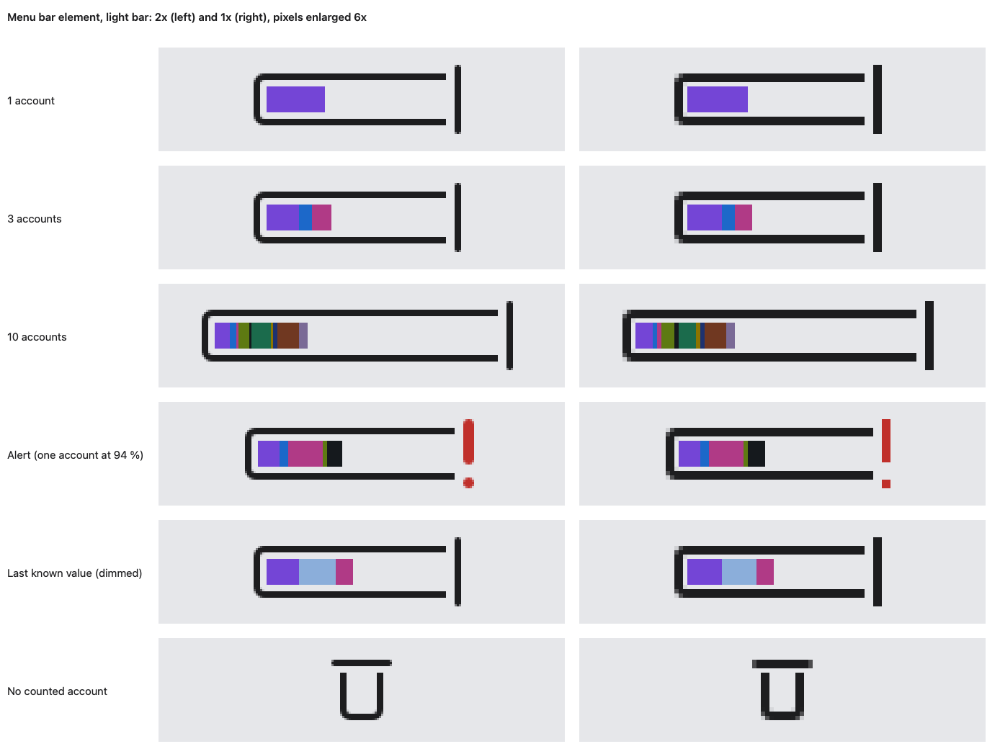
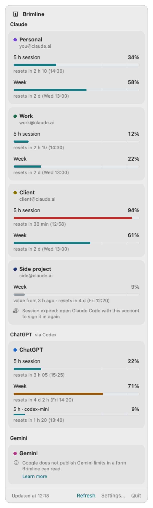
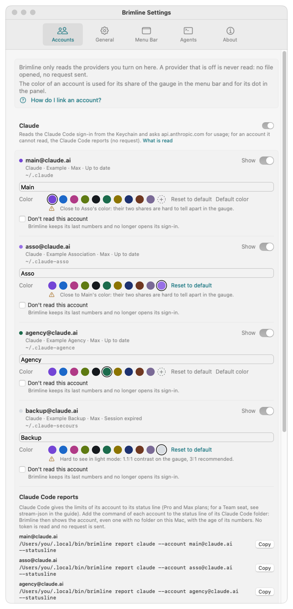
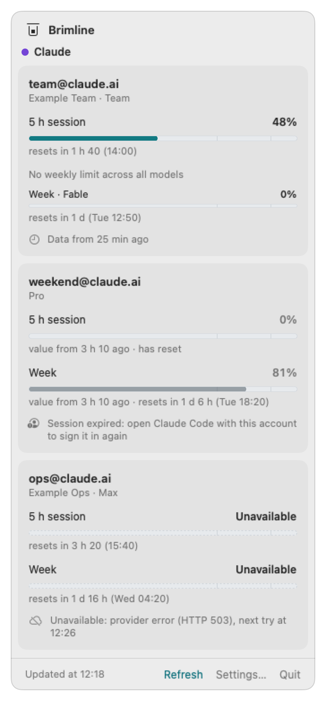
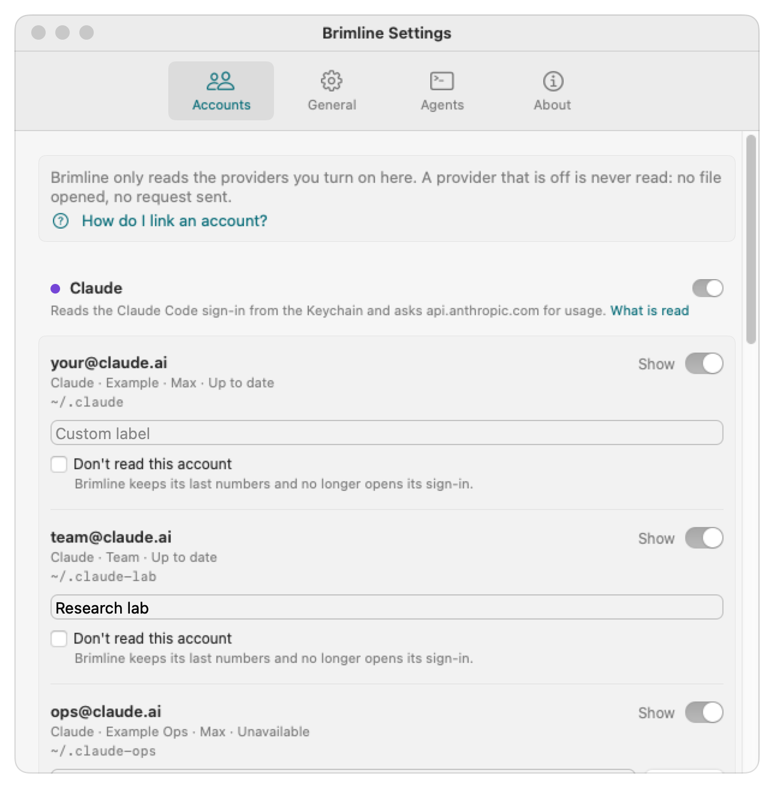
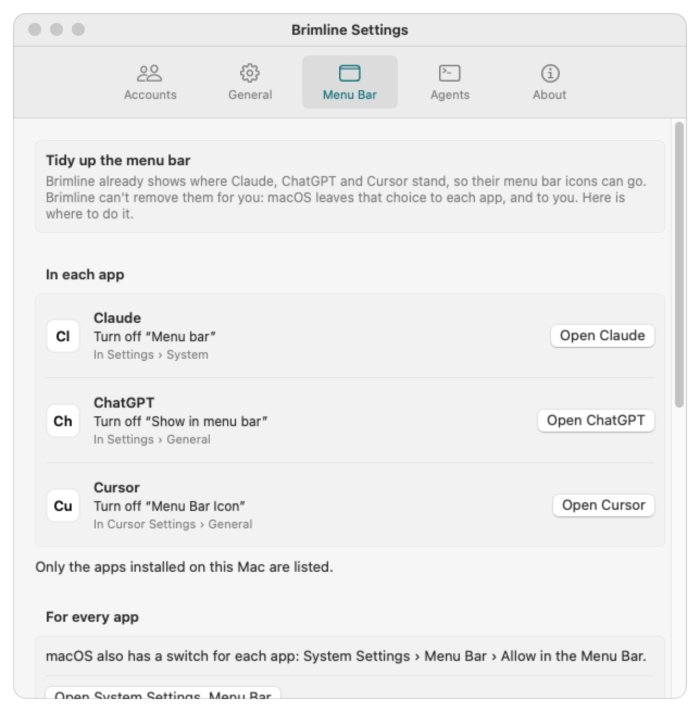

# Brimline

[](LICENSE)
[](#install)
[](CHANGELOG.md)

*[Version française](README.fr.md)*

**Brimline shows, in your Mac's menu bar, how much of each AI subscription limit you have left: account by account, each one named by its email address.**

If you use several Claude accounts (or Claude and ChatGPT, Gemini, Grok, Cursor), the built-in indicators show one account at a time, without telling you which one. Brimline puts them side by side: the five hour session, the week, the week per model, and when each one resets.

```bash
curl -fsSL https://brimline.thanaelfontaine.eu/install.sh | sh
```

**A Mac app only:** macOS 14 (Sonoma) or later, Apple silicon or Intel. There is no Windows or Linux version. Other ways to install: [below](#install).

<p align="center">
  
  
</p>

The same numbers are readable by your agents (a command with JSON output and a local MCP server), so an agent can pick the account that still has room.

> **Status:** private, not announced: the repository and the site are not public yet, so the install line and the download links above and below only work once they are. The current version is 0.2.1. It works with Claude (through Claude Code, with several accounts) and adds ChatGPT (through Codex), Gemini (through Antigravity), Grok and Cursor, each tried on a real account on 27 October 2026: the table [below](#providers) says on which plan and with what result. [CHANGELOG.md](CHANGELOG.md) says what exists.

The *brim* is the edge a tank fills up to, and the *line* is the limit drawn above it: Brimline shows how close you are to the edge, at a glance.

*Formerly Sightglass: renamed on 26 October 2026, before its first public release (the reason is in the [changelog](CHANGELOG.md)).*

## How it works

1. **It finds your accounts.** Each Claude account is a Claude Code folder on your Mac (`~/.claude`, `~/.claude-work`, ...), signed in once with `/login`: Brimline lists them by itself. ChatGPT, Gemini, Grok and Cursor are read through their own official tools, once you switch them on in Settings.
2. **It reads, never writes.** Brimline uses the sign-in those tools already keep and asks each provider for your usage, the same request the official tool makes. It never signs you in, never renews or copies a token, and sends nothing anywhere else.
3. **It sums it up in the menu bar.** One gauge, one colored part per account, and a red "!" as soon as one account reaches 90 %. Click it for the window: one card per account, one bar per limit, and when it resets.
4. **Your agents can ask too.** `brimline status --json` and a local MCP server (`best_account`) let an agent pick the account that still has room.

## Install

Brimline is a **Mac app only**: macOS 14 (Sonoma) or later, on Apple silicon or Intel (one universal app; tried on Apple silicon only so far). There is no Windows or Linux version.

**In one line**, in Terminal:

```bash
curl -fsSL https://brimline.thanaelfontaine.eu/install.sh | sh
```

The script ([read it first](https://brimline.thanaelfontaine.eu/install.sh) if you like) downloads the latest release from GitHub, checks it against its published SHA-256, puts `Brimline.app` in `/Applications` (or where Brimline already is, or `~/Applications` when `/Applications` is not writable), links the `brimline` command at `~/.local/bin/brimline` and opens the app. No administrator password, nothing written outside those places. Run the same line again to update.

**Or the disk image:** download [Brimline.dmg](https://github.com/ThanaelFontaine/Brimline/releases/latest/download/Brimline.dmg) (its SHA-256 is [next to it](https://github.com/ThanaelFontaine/Brimline/releases/latest)), open it and drag Brimline onto Applications. Brimline is not notarized by Apple (that needs a paid Apple Developer account), so macOS blocks it the first time you open it: close the message, then go to **System Settings, Privacy & Security** and click **Open Anyway**, then **Open** ([Apple's page](https://support.apple.com/en-us/102445)). macOS asks this once.

**Or from the source**, with Apple's Command Line Tools (no Xcode, no Apple account):

```bash
git clone https://github.com/ThanaelFontaine/Brimline.git
cd Brimline
scripts/build_app.sh     # builds build/Brimline.app
scripts/install.sh       # copies it to ~/Applications, links the command, opens the app
```

Brimline then lives in the menu bar, not in the Dock: look for its gauge at the top right of the screen. Requirements, what macOS shows, updating and uninstalling: [docs/install.md](docs/install.md).

## Principles

- **Read only.** Brimline reads the sign-in tokens your AI tools already store on your Mac (for Claude Code, the macOS Keychain; for Codex, Grok and Cursor, a file each of them keeps). It never refreshes, rewrites or moves them, so it can never sign you out of a tool. An expired token is shown as "Session expired", not repaired behind your back. **One exception, said out loud:** to read Gemini, Brimline launches Google's own command `agy --print /usage`, and Google's program may then renew its own sign-in; Brimline neither reads nor writes that sign-in (see [SECURITY.md](SECURITY.md)).
- **Off until you turn it on.** Claude is on; every other provider is off until you switch it on in the settings (or with `brimline providers enable <name>`), and a provider that is off is not touched at all. An account marked "Don't read this account" is never read either.
- **Nothing leaves your Mac**, except the usage requests to each provider. No server, no telemetry, no token ever written to a log.
- **One account, one line, one address.** Several accounts per provider are a first-class case, not an afterthought.
- **Open to any provider.** Each provider is a small plugin: Claude, ChatGPT (Codex), Gemini (Antigravity), Grok and Cursor so far.
- **Honest about fragility.** As far as we know (October 2026), no provider documents an endpoint for subscription limits (Google documents a command, `/usage` in Antigravity, but not the format of its text). Brimline uses the same internal endpoints as the official tools, which can change without notice. When one breaks, Brimline says so instead of showing a wrong number. And it says what it has tried: a provider is called "read and checked" only for the plan it was tried on (next section).

Why another tool, when good ones exist (CodexBar, ClaudeBar, Claude Usage Tracker)? See [docs/why.md](docs/why.md).

## Providers

<p align="center">
  
</p>

Each new provider was tried on **27 October 2026** on the maker's own account, **only on the plan in the table**. Nothing is claimed for a plan that was not tried, a paid one in particular. The numbers in the pictures are invented.

| Provider | Read through | Source | Plan tried (27/10/2026) | State |
|---|---|---|---|---|
| Claude | Claude Code sign-in (Keychain); for an account it cannot read, the [Claude Code reports](docs/accounts.md#claude-code-reports-an-account-brimline-cannot-read-directly) | Not documented (the reports: status line documented) | Real accounts, since v0.1.0 | Read and checked |
| ChatGPT | Codex (`~/.codex/auth.json`) | Not documented (Codex's public code) | ChatGPT Free: the month, 0 % | Read and checked on that plan; comparison with OpenAI's usage page pending |
| Gemini | Antigravity CLI (`agy --print /usage`) | Command documented, text format not | A Google account (`agy` does not say the plan): five limits, none used | Read and checked, except that the percentage was seen at 100 % remaining only, and the reference is `agy`'s own text |
| Grok | Grok CLI (`~/.grok/auth.json`) | Not documented (the CLI's public code) | A free account: **xAI returns no credit limit, so no percentage is shown** | Read and checked for that sentence only; xAI has no page to compare with |
| Cursor | Cursor's app sign-in (its state database) | Not documented (CodexBar's public code) | Cursor Free: the month, Auto and API, 0 % | Read and checked on that plan; comparison with the cursor.com usage page pending |

What exactly is read, where the source comes from and what each try showed: [docs/providers.md](docs/providers.md).

## Use

- **Link your accounts.** One Claude Code folder per Claude account, chosen with `CLAUDE_CONFIG_DIR` and signed in once with `/login`; Brimline finds them by itself. Other providers: switch them on in Settings, Accounts. Step by step: [docs/accounts.md](docs/accounts.md).
- **Read the menu bar.** The glyph lies down and becomes a gauge: one colored part per account (its tightest limit), so the whole gauge is their average. As soon as one account reaches 90 %, the limit line turns into a red "!" (a shape, not only a color). The tooltip and VoiceOver say it in words.

  
- **Open the window.** Cards grouped by provider, one gauge per limit with its percentage and its reset time ("resets in 2 h 10 (14:30)"). A provider that gives no readable limit says so in one sentence, never with a made-up number.
- **Settings** (from the window, or by opening the app again): hide an account or give it a label, choose its color, switch each provider on or off, mark an account "Don't read this account", change the refresh interval (2 to 15 minutes), show the percentage next to the gauge, open at login.
- **Tidy the menu bar** (Settings, Menu Bar): where to turn off the icons of Claude, ChatGPT and Cursor, and an optional "Hide without removing", with no permission asked: [docs/menu-bar.md](docs/menu-bar.md).

Every state is said in words, never by color alone:

<p align="center">
  
  
</p>

<p align="center">
  
  
  
</p>

## For agents

```bash
brimline status --json                                              # every account, every limit, with the age of the data
claude mcp add --scope user brimline -- ~/.local/bin/brimline mcp   # MCP tools: list_accounts, get_usage, best_account
brimline status --provider chatgpt --json                           # one provider only (claude, chatgpt, gemini, grok, cursor)
```

All three read the cache written by the app and never see a token (only `brimline status --live` reads the Keychain, like the app). Details and JSON format: [docs/agents.md](docs/agents.md).

## Anthropic's terms

Brimline is an independent project: it is not made, endorsed or supported by Anthropic. Anthropic's documentation ([Legal and compliance, Authentication and credential use](https://code.claude.com/docs/en/legal-and-compliance)) says that OAuth sign-ins are meant for Claude Code and Anthropic's own apps, and that third-party developers may not offer Claude.ai login in their apps, route requests through Free, Pro or Max plan credentials on behalf of their users, or collect, store or intermediate Claude.ai credentials or session tokens.

What Brimline does, so you can judge for yourself: it runs on your own Mac and reads the sign-in Claude Code already stored there, read only. It never signs you in, never writes, renews or copies the token, and sends it only to Anthropic, to ask for your own usage numbers, under its own name (`User-Agent: Brimline/<version>`). It sends no prompts and uses no model. We do not claim Anthropic allows this use: read the terms that apply to your plan and decide. The same page says Anthropic may enforce these restrictions without prior notice: the risk, if any, is on the account Brimline reads.

## Documentation

- [Linking your accounts](docs/accounts.md) ([en français](docs/accounts.fr.md))
- [Providers: what is read, from where, what was tried](docs/providers.md)
- [Installing](docs/install.md)
- [Agents: command and MCP server](docs/agents.md)
- [FAQ](docs/faq.md)
- [Why Brimline](docs/why.md)
- [Security model](SECURITY.md)
- [Design: colors, glyph, icon](design/DA.md) (in French)

## License

Brimline's source code is public, but it is not open source in the OSI sense: [PolyForm Shield 1.0.0](LICENSE), © 2026 Thanaël Fontaine. Anyone may use, modify and share it, at work too, or to sell their own products and services; nobody may provide a product that competes with Brimline, even for free (reselling it, offering it as a hosted service). The author keeps every right, including selling his own hosted version.

Contributions are welcome: see [CONTRIBUTING.md](CONTRIBUTING.md). Security reports: see [SECURITY.md](SECURITY.md).
