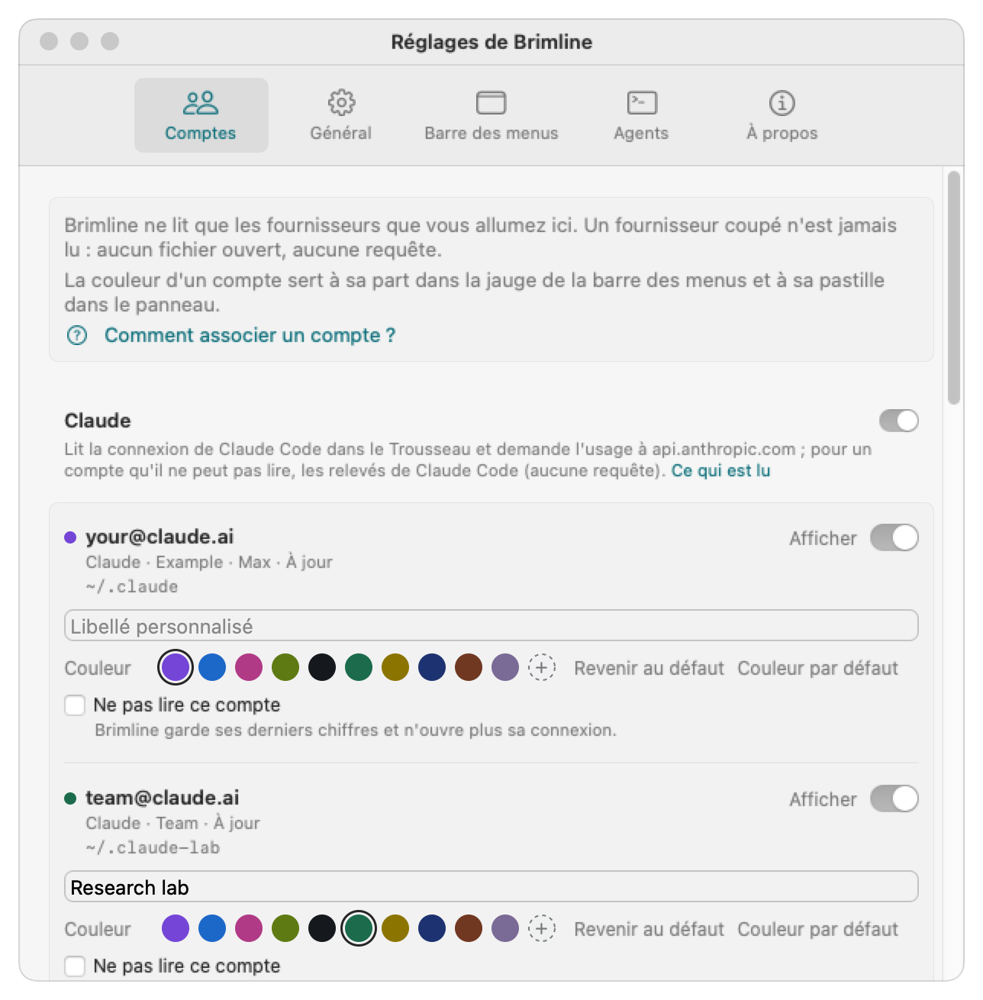

# Associer vos comptes

*[English version](accounts.md)*

Brimline montre une ligne par compte. Pour Claude, un compte est un **dossier de configuration de Claude Code** : Brimline trouve les dossiers, lit l'adresse avec laquelle chacun est connecté, puis demande à Anthropic où en sont les limites de ce compte. Vous ne tapez jamais de mot de passe ni de jeton dans Brimline.

## En bref

1. Donnez à chaque compte Claude son propre dossier de configuration de Claude Code, choisi avec la variable `CLAUDE_CONFIG_DIR`.
2. Connectez-vous une fois dans chaque dossier avec Claude Code (`/login`).
3. Ouvrez Brimline : chaque dossier nommé `~/.claude` ou `~/.claude-quelquechose` apparaît tout seul. Tout autre dossier s'ajoute dans **Réglages, Comptes, Ajouter un dossier Claude Code…**.

## 1. Un dossier par compte

Claude Code range ses réglages, son historique et sa connexion dans un dossier de configuration. Par défaut, c'est `~/.claude`. La variable `CLAUDE_CONFIG_DIR` en désigne un autre, et chaque dossier a sa propre connexion claude.ai. C'est la façon que propose la documentation de Claude Code pour rester connecté à plusieurs comptes ([Log in with multiple accounts](https://code.claude.com/docs/en/authentication#log-in-with-multiple-accounts), en anglais).

Votre premier compte vit en général déjà dans `~/.claude`. Pour un deuxième, ajoutez un alias à `~/.zshrc` (ou `~/.bashrc`) :

```bash
alias claude-work='CLAUDE_CONFIG_DIR=~/.claude-work claude'
```

Ouvrez un nouveau terminal, puis lancez `claude-work`. Prenez autant de dossiers que de comptes : `~/.claude-equipe`, `~/.claude-client`, etc.

**Nommez-les `~/.claude-quelquechose`** pour que Brimline les trouve seul. Un dossier ailleurs fonctionne aussi : ajoutez-le à la main (étape 3).

## 2. Se connecter dans chaque dossier

Lancez Claude Code avec l'alias du dossier (`claude-work`) et connectez-vous quand il le demande, ou tapez `/login`. Claude Code :

- écrit l'adresse du compte dans `.claude.json`, dans le dossier (pour `~/.claude`, c'est le fichier `~/.claude.json` de votre dossier personnel) ;
- range la connexion dans le Trousseau de macOS, dans un élément propre à ce dossier.

Vérifiez avec `/status` dans Claude Code que la bonne adresse est connectée.

## 3. Brimline

Brimline cherche les comptes à son lancement, et de nouveau quand vous cliquez sur **Rechercher à nouveau** dans les réglages :

- `~/.claude` (adresse lue dans `~/.claude.json`) ;
- chaque dossier `~/.claude-*` qui contient un `.claude.json` ;
- les dossiers ajoutés avec **Ajouter un dossier Claude Code…** (le sélecteur montre les dossiers cachés).

Dans **Réglages, Comptes**, chaque fournisseur a son bloc : un interrupteur, une ligne qui dit ce que Brimline lit et où il le demande, et ses comptes. Pour un compte, vous pouvez le masquer dans la fenêtre de la barre des menus, lui donner un libellé, cocher **Ne pas lire ce compte** (Brimline garde ses derniers chiffres, en gris avec leur âge, et n'ouvre plus sa connexion), ou retirer un dossier ajouté à la main.



## Ce que Brimline lit, et ce qu'il ne fait jamais

Pour chaque dossier, Brimline lit :

- **l'identité du compte** dans `.claude.json` : `oauthAccount.emailAddress`, puis `organizationName` et `seatTier` comme étiquette secondaire. Rien d'autre de ce fichier ;
- **la connexion** dans l'élément du Trousseau que Claude Code a créé pour ce dossier. Il s'appelle `Claude Code-credentials` pour `~/.claude`, et `Claude Code-credentials-` suivi de 8 caractères hexadécimaux pour tout autre dossier (le début du SHA-256 du chemin du dossier ; comportement observé de Claude Code, non documenté, donc susceptible de changer). Brimline le lit avec l'outil du système `/usr/bin/security`, par son nom exact, sans jamais parcourir le Trousseau. [SECURITY.md](../SECURITY.md) explique pourquoi (en anglais).

De la connexion, seul le jeton d'accès sert, en mémoire, le temps d'une requête vers `https://api.anthropic.com/api/oauth/usage`. Brimline n'utilise jamais le jeton de renouvellement, ne renouvelle jamais une connexion, n'écrit jamais dans le Trousseau et n'écrit jamais un jeton dans un fichier, un journal ou ses réponses aux agents.

## ChatGPT, par Codex

Brimline lit les limites de ChatGPT par Codex, l'outil officiel : il n'y a rien à saisir dans Brimline.

1. Connectez Codex à votre compte ChatGPT (`codex login`, ou l'écran de connexion de Codex). Par défaut, Codex range sa connexion dans `~/.codex/auth.json`. Si vous avez réglé Codex pour la ranger dans le Trousseau, Brimline ne peut pas la lire et le dit.
2. Allumez ChatGPT dans **Réglages, Comptes** (ou `brimline providers enable chatgpt`) : il démarre coupé.
3. Brimline montre une carte pour `~/.codex`. Un dossier Codex ailleurs (`CODEX_HOME`) s'ajoute avec **Ajouter un dossier Codex…** dans **Réglages, Comptes**, sous ChatGPT (le sélecteur montre les dossiers cachés).

Brimline ne lit que `auth.json` dans ce dossier, et de lui seulement le mode de connexion, le jeton d'accès et l'identifiant du compte. Il ne renouvelle jamais la connexion : si Codex est resté fermé longtemps, la carte dit « Ouvrez Codex pour rafraîchir la connexion. » Un compte connecté par une clé d'API n'a pas de limite d'abonnement à montrer. Détails dans [providers](providers.md) (en anglais).

## Cursor

Cursor n'a pas de compte à relier : Brimline utilise la connexion que l'app Cursor garde déjà. Connectez-vous à Cursor, puis allumez Cursor dans **Réglages, Comptes** (ou `brimline providers enable cursor`) : il démarre coupé. Brimline regarde le seul fichier où Cursor range son état et, quand la connexion y est écrite en clair, demande à cursor.com l'usage de votre forfait : le cycle, avec son pourcentage et sa remise à zéro (et les pools Auto et API quand Cursor les donne). Si Cursor protège sa connexion (ou la garde en mode WAL et est fermé), la carte le dit et renvoie à cursor.com, Dashboard, Usage. Si la connexion a expiré, la carte dit « Ouvrez Cursor pour rafraîchir la connexion. » Brimline ne la renouvelle jamais, ne lit jamais l'élément du Trousseau de Cursor et ouvre ce fichier en lecture seule, sans rien créer dans le dossier de Cursor (si Cursor garde ce fichier en mode WAL, seulement pendant que Cursor tourne). Détails dans [providers](providers.md).

## Gemini, par Antigravity

Gemini se lit par l'outil de Google, Antigravity CLI (`agy`), que vous installez et dans lequel vous vous connectez vous-même : Brimline ne vous connecte jamais. Allumez Gemini dans **Réglages, Comptes** (ou `brimline providers enable gemini`). Quand `agy` est dans `~/.local/bin/agy`, Brimline lance `agy --print /usage` (la commande officielle de Google pour vos limites ; l'outil de Google peut renouveler lui-même sa connexion) et montre l'usage de chaque modèle. Sans lui, une carte vous dit où sont vos limites (l'app Gemini, Réglages, Limites d'utilisation). **Gemini n'est pas encore lu et vérifié :** tant qu'un vrai Antigravity n'a pas été essayé, Brimline ne le lance pas. Détails dans [providers](providers.md) (en anglais) et [SECURITY.md](../SECURITY.md) (en anglais).

## Grok, par le CLI Grok

Brimline lit les limites de Grok par le CLI Grok, l'outil officiel : il n'y a rien à saisir dans Brimline.

1. Connectez le CLI Grok à votre compte xAI (`grok login`, qui ouvre votre navigateur). Le CLI range sa connexion dans `~/.grok/auth.json`.
2. Allumez Grok dans **Réglages, Comptes** (ou `brimline providers enable grok`) : il démarre coupé.
3. Brimline montre une carte quand le dossier `~/.grok` existe. Sans le CLI Grok, pas de carte : xAI ne publie les limites de Grok que pour le CLI, et les autres sont dans les réglages de votre compte Grok.

Brimline ne lit que `auth.json` dans ce dossier, et de lui seulement la connexion d'un compte xAI : le jeton de session et l'identifiant, en mémoire, le temps d'une requête vers `https://cli-chat-proxy.grok.com`. Il ne renouvelle jamais la connexion : si le CLI Grok est resté fermé longtemps, la carte dit « Ouvrez le CLI Grok pour rafraîchir la connexion. » Un CLI connecté par une clé d'API n'a pas de limite d'abonnement à montrer. En début de période, la carte dit « Pas encore de chiffre pour cette période. » Détails dans [providers](providers.md) (en anglais).

## Situations courantes

| Ce que vous voyez | Ce que ça veut dire | Que faire |
|---|---|---|
| **Session expirée** | Le jeton d'accès du compte a expiré. Claude Code le renouvelle à sa prochaine utilisation ; Brimline jamais. Ses derniers chiffres restent, en gris, avec leur âge. | Ouvrez Claude Code avec ce compte (n'importe quelle commande suffit). |
| **À reconnecter** | Anthropic a refusé le jeton (HTTP 401). | Lancez `/login` dans Claude Code avec ce dossier. |
| **Pas connecté** | Aucun élément du Trousseau pour ce dossier. | Lancez Claude Code avec ce dossier et connectez-vous. |
| **Indisponible** | Anthropic n'a pas répondu utilement (trop de requêtes, erreur du serveur, réseau, ou réponse que Brimline ne comprend pas). Brimline réessaie plus tard, en attendant un peu plus à chaque fois. | En général, rien. Si ça dure, le point d'accès a peut-être changé : voir la [FAQ](faq.md) (en anglais). |
| **Pas de limite hebdomadaire globale** | Le compte (souvent un siège d'équipe) n'a pas de limite hebdomadaire tous modèles ; seules la session et les limites par modèle s'appliquent. | Rien. |
| Un compte manque | Son dossier ne s'appelle pas `~/.claude-*`, ou n'a pas encore de `.claude.json`. | Connectez-vous une fois dans ce dossier, ou ajoutez-le à la main. |

À la première lecture d'un élément, macOS peut afficher une demande du Trousseau si l'élément n'autorise pas déjà l'outil `security`. Dans nos essais avec les éléments de Claude Code, aucune demande n'est apparue ; si l'une apparaît, lisez ce qu'elle demande avant d'autoriser.
