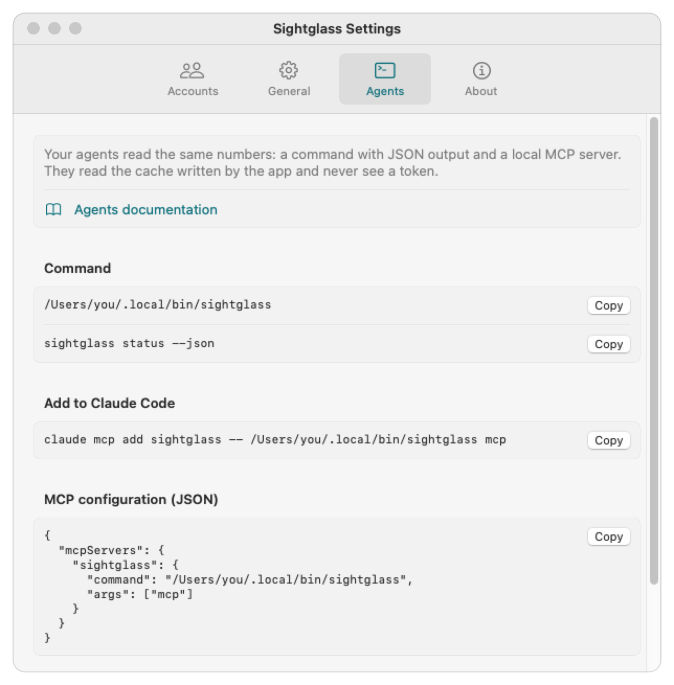

# Sightglass for agents

Your agents can read the same numbers as the menu bar, so they can pick an account that still has room instead of failing in the middle of a task. Two ways: a command with JSON output, and a local MCP server.

Both read the **cache written by the Sightglass app** (`~/Library/Application Support/Sightglass/usage.json`), refreshed every 5 minutes by default. They never read the Keychain and never see a token, except `sightglass status --live` (below), which reads like the app. Every answer says how old its numbers are.

## Where the command is

The command is inside the app: `Sightglass.app/Contents/Helpers/sightglass`. `scripts/install.sh` links it to `~/.local/bin/sightglass`. **Settings, Agents** shows its exact path, with ready to copy snippets.



## The command

```text
sightglass status [--json] [--live]   Usage of each account
sightglass accounts [--json]          Accounts found on this Mac (no Keychain read)
sightglass mcp                        Local MCP server over stdio
sightglass --version
```

- `status` reads the cache, even when the app is not running (check `age_seconds`). Only when there is no cache at all does it say so and exit with code 2.
- `status --live` reads every account now, with the same code as the app: it reads the Keychain through `/usr/bin/security` and asks Anthropic. It does not write the cache (the app stays the only writer).
- Exit codes: 0 on success, 2 when there is no cache yet, 64 for a wrong command or option.

### `sightglass status --json`

```json
{
  "accounts" : [
    {
      "age_seconds" : 74,
      "email" : "you@example.com",
      "fetched_at" : "2026-10-26T11:18:46Z",
      "folder" : "<home>/.claude-work",
      "hidden" : false,
      "id" : "claude:<home>/.claude-work",
      "label" : null,
      "limits" : [
        {
          "current_percent" : 34,
          "kind" : "session",
          "model" : null,
          "percent" : 34,
          "resets_at" : "2026-10-26T13:30:00Z",
          "resets_in_seconds" : 7800
        },
        {
          "current_percent" : 0,
          "kind" : "weekly_model",
          "model" : "Fable",
          "percent" : 0,
          "resets_at" : "2026-10-27T12:00:00Z",
          "resets_in_seconds" : 88800
        }
      ],
      "message" : null,
      "no_global_weekly_limit" : true,
      "organization" : "Example Team",
      "provider" : "claude",
      "stale" : false,
      "status" : "ok"
    }
  ],
  "age_seconds" : 74,
  "generated_at" : "2026-10-26T11:18:46Z",
  "schema_version" : 1,
  "source" : "cache"
}
```

Fields:

| Field | Meaning |
|---|---|
| `kind` | `session` (five hour window), `weekly` (all models), `weekly_model` (one model, named in `model`) |
| `percent` | Share used, 0 to 100, as Anthropic last reported it |
| `current_percent` | The share that applies now: 0 once `resets_at` has passed |
| `status` | `ok`, `expired` (token expired, numbers are the last known ones), `reconnect` (sign-in refused), `unavailable`, `signed_out`, `pending` |
| `stale` | `true` when the numbers are older than two refresh intervals, or the last read failed |
| `no_global_weekly_limit` | `true` for plans without a weekly limit across all models (often team seats) |
| `age_seconds` | Age of the numbers (per account) or of the cache (top level) |

Every key is always present; a missing value is `null`. `<home>` stands for your home folder.

## The MCP server

`sightglass mcp` speaks the [Model Context Protocol](https://modelcontextprotocol.io/specification/2025-06-18) over stdio (JSON-RPC 2.0, one message per line). It answers `initialize`, `ping`, `tools/list` and `tools/call`.

### Add it to Claude Code

```bash
claude mcp add sightglass -- ~/.local/bin/sightglass mcp
```

### Or to any MCP client

```json
{
  "mcpServers": {
    "sightglass": {
      "command": "<home>/.local/bin/sightglass",
      "args": ["mcp"]
    }
  }
}
```

Replace `<home>` with your home folder (absolute path: configuration files do not expand `~`). **Settings, Agents** gives both snippets with your path filled in.

### Tools

All three are read only.

| Tool | Arguments | Returns |
|---|---|---|
| `list_accounts` | none | Each account: id, provider, email, organization, label, folder, hidden, status |
| `get_usage` | `account` (optional: an email or an id), `include_hidden` (optional, default false) | The same JSON as `sightglass status --json` |
| `best_account` | `window` (`any`, `session` or `week`; default `any`), `model` (optional, for example `Fable`) | `best` (the account with the most room left), `ranking` (all, best first), each with `headroom_percent` and the `binding_limit` that sets it |

How `best_account` ranks: for each account with numbers, it takes the limits that apply (`any`: the session, the week across all models, and the model's week when `model` is given; `session`: the session only; `week`: the weekly limits only), keeps the tightest one, and sorts by room left. Hidden accounts and accounts whose sign-in was refused are left out; an account whose token merely expired stays in, since Claude Code renews it when used. Unavailable accounts come after all the others, since their numbers may be old. An account that has none of the limits asked for (a team seat without a weekly limit, asked for `week`) is judged on its tightest limit, so a full session never reads as 100% room. Ties go to the freshest numbers. A window whose reset time has passed counts as empty.

Results come both as text (JSON) and as `structuredContent`. When the app has not written the cache yet, tools answer with `isError: true` and a sentence saying to open the app.

### Example

```text
→ {"jsonrpc":"2.0","id":1,"method":"tools/call","params":{"name":"best_account","arguments":{"model":"Fable"}}}
← {"jsonrpc":"2.0","id":1,"result":{"content":[{"type":"text","text":"{ ... }"}],"structuredContent":{"best":{"email":"you@example.com","headroom_percent":66, ...},"ranking":[...],"window":"any","model":"Fable","age_seconds":74},"isError":false}}
```

## Good habits for agents

- Check `age_seconds` and `stale` before trusting a number.
- Treat `unavailable` as "unknown", not as "free".
- The numbers come from an undocumented Anthropic endpoint (see the [FAQ](faq.md)): use them to choose, not as a guarantee.
