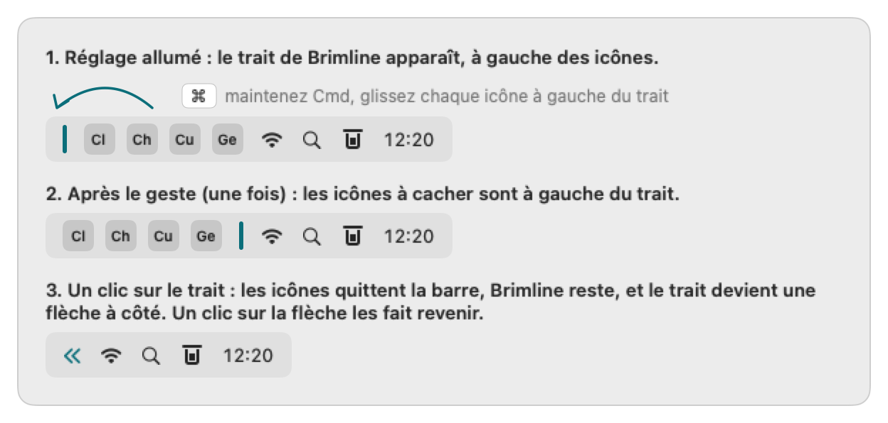
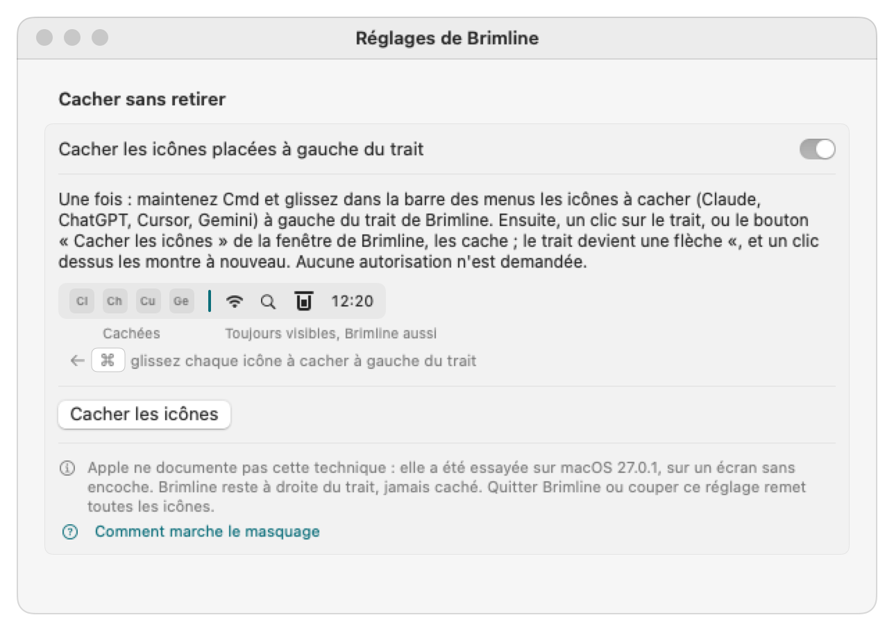

# La barre des menus : la ranger, ou cacher des icônes

*[English version](menu-bar.md)*

Claude, ChatGPT, Cursor et Gemini posent chacun leur icône dans la barre des menus, et Brimline montre déjà où ils en sont. **Réglages, Barre des menus** donne deux façons de faire de la place. Aucune ne demande d'autorisation (ni Accessibilité, ni Enregistrement de l'écran), n'utilise d'API privée ni n'écrit dans un fichier de macOS ou d'une autre app.

## 1. Retirer une icône pour de bon (ranger)

Pour Claude, ChatGPT et Cursor installés sur le Mac, l'onglet nomme l'interrupteur de l'app (« Barre de menus » dans Claude, « Afficher dans la barre des menus » dans ChatGPT, « Menu Bar Icon » dans Cursor), dit où il est et ouvre l'app. Il ouvre aussi Réglages Système sur Barre des menus, où macOS a son propre interrupteur « Autoriser dans la barre des menus » par app, et explique le geste Cmd + glisser hors de la barre. Les noms des interrupteurs sont ceux lus dans les apps le 27 octobre 2026 et peuvent changer avec leurs versions.

Brimline ne peut pas retirer lui-même l'icône d'une autre app : macOS laisse ce choix à chaque app, et à vous.

## 2. Cacher des icônes sans les retirer

**Coupé par défaut.** Allumez **Réglages, Barre des menus, Cacher sans retirer, « Cacher les icônes placées à gauche du trait »**.

  

1. **Le trait apparaît.** Brimline ajoute un élément à lui dans la barre des menus : un fin trait vertical. La première fois, il arrive à gauche des autres icônes (macOS y place tout nouvel élément).
2. **Une fois, le geste.** Maintenez Cmd et glissez, dans la barre des menus, chaque icône à cacher (Claude, ChatGPT, Cursor, Gemini) à gauche du trait. macOS retient la place de chaque icône, celle du trait aussi, d'un lancement à l'autre.
3. **Cacher et montrer.** Dans la fenêtre de Brimline, **« Cacher les icônes »** cache tout ce qui est à gauche du trait ; **« Montrer les icônes cachées »** le fait revenir. Le même bouton est dans les Réglages.

  

### Comment ça marche

Brimline ne touche jamais à l'icône d'une autre app. Pour cacher, il rend **son propre trait** très long : le trait s'allonge vers la gauche et pousse les icônes voisines hors de la partie visible de la barre, où macOS ne les dessine pas. Pour les montrer, le trait reprend sa longueur normale. Hidden Bar et Dozer utilisaient cette technique avant macOS 27.

**Apple ne la documente pas.** Elle a été essayée sur **macOS 27.0.1, sur un écran de 1920 pt sans encoche** (28 octobre 2026). Elle **n'a pas été essayée sur un MacBook à encoche, ni avec plusieurs écrans**, ni après une mise en veille ou un verrouillage. Une version suivante de macOS pourrait la casser ; Brimline ne devrait alors rien cacher, et toutes les icônes devraient rester visibles (non essayé).

Ce que les essais ont montré, et ce que Brimline en fait :

- La longueur doit rester sous la moitié de l'écran environ : dès 960 pt (sur 1920), macOS retire le trait et ne cache rien (les 10 000 pt de Hidden Bar ne marchent plus sous macOS 27). La limite était la même aux deux places mesurées : trait à 838 pt, 940 pt ont poussé et 960 pt ont fait retirer le trait ; trait à 1512 pt (28 octobre 2026), 900 à 940 pt ont poussé et 950 pt l'ont fait retirer. Les autres places n'ont pas été essayées. Brimline prend **48 % de l'écran le plus étroit** sous macOS 27 et après (921 pt sur 1920), recalculés à chaque écran branché, débranché ou redimensionné (les icônes sont montrées, le trait se pose, puis la vérification repart). Sous macOS 26 et avant, il garde la longueur de Hidden Bar.
- Une icône poussée sur les menus de l'app au premier plan n'est pas dessinée ; une icône qui tient encore à côté d'eux reste visible. Quand le trait est loin à droite (son bord gauche à plus de 48 % de l'écran plus 50 pt du bord gauche), la poussée peut donc laisser visibles les icônes les plus proches du trait, davantage avec une app aux menus courts. Brimline cache quand même ce qu'il peut et le dit : « Des icônes peuvent rester visibles : macOS laisse le trait les pousser d'environ la moitié de l'écran. Ne gardez à gauche du trait que les icônes à cacher (maintenez Cmd et glissez les autres à sa droite). » Jusqu'à la version 0.2.1, il refusait de cacher dans ce cas.
- Aucun signal ne dit que les icônes ont vraiment quitté la barre : Brimline ne lit la place de son trait que lorsque les icônes sont montrées, et refuse quand il ne peut pas la lire.

### Vous retrouvez toujours vos icônes

- **Brimline reste à droite du trait, il n'est donc jamais caché**, ni sa fenêtre avec le bouton « Montrer les icônes cachées ». Le trait est posé après l'icône de Brimline, il arrive donc à sa gauche ; et avant chaque masquage, Brimline vérifie que sa propre icône est à droite du trait, et refuse sinon (« L'icône de Brimline est à gauche du trait : glissez-la à droite du trait, sinon elle serait cachée aussi. »).
- **Couper le réglage** montre toutes les icônes et retire le trait de la barre : réglage coupé, il n'y a aucun trait.
- **Quitter Brimline** fait revenir toutes les icônes : le trait appartient au processus de Brimline et part avec lui. Après un plantage, ce devrait être pareil, par construction (le trait part avec l'app), non essayé. À chaque lancement, les icônes partent montrées, même si elles étaient cachées au dernier arrêt.
- **Rouvrir Brimline** (Finder, Spotlight) montre les icônes cachées et ouvre les réglages : une voie de retour qui ne dépend pas de la barre des menus.
- Le trait ne peut pas être glissé hors de la barre, et ne quitte jamais Brimline.

### Ce qu'il laisse derrière lui

La place du trait est gardée par macOS, comme celle de chaque icône que vous glissez (sous macOS 27, dans ses propres préférences de la barre des menus, sous le nom de l'exécutable de Brimline et `brimline-separator`). Brimline n'écrit jamais dans ce fichier. Brimline peut aussi apparaître dans Réglages Système, Barre des menus, Autoriser dans la barre des menus, comme toute app qui a une icône. Il n'a pas été vérifié si couper puis rallumer le réglage garde la place du trait : si le trait revient à gauche des icônes, refaites le geste.
