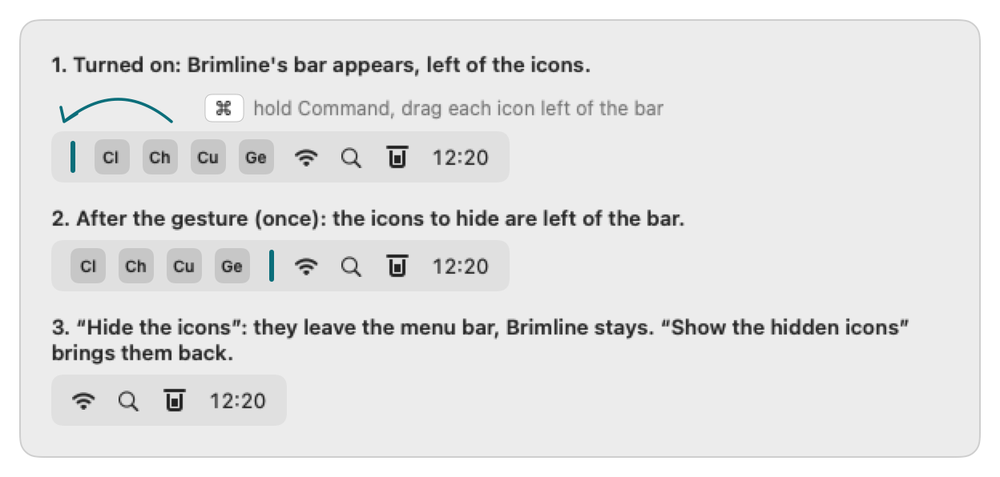
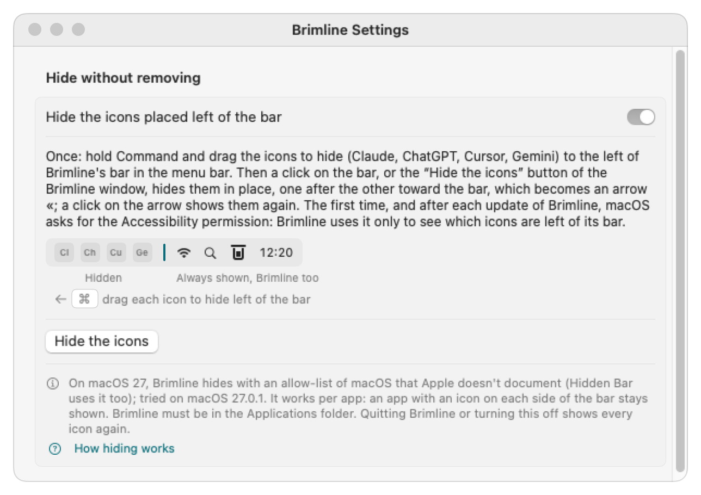

# The menu bar: tidy it, or hide icons

*[Version française](menu-bar.fr.md)*

Claude, ChatGPT, Cursor and Gemini each put their own icon in the menu bar, and Brimline already shows where they stand. **Settings, Menu Bar** gives two ways to make room. The first (tidy up) asks for nothing. The second (hide) uses, on macOS 27 and later, a private API of macOS and the Accessibility permission, only to read where the icons of the other apps are; on macOS 26 and before it asks for no permission and uses no private API. Neither writes a file of macOS or of another app.

## 1. Remove an icon for good (tidy up)

For each of Claude, ChatGPT and Cursor installed on the Mac, the tab names the app's own switch ("Turn off “Menu bar”" in Claude, "Show in menu bar" in ChatGPT, "Menu Bar Icon" in Cursor), says where it is and opens the app. It also opens System Settings on Menu Bar, where macOS has its own "Allow in the Menu Bar" switch for each app, and explains the Command-drag out of the menu bar. The names of the switches are the ones read in the apps on 27 October 2026 and can change with their versions.

Brimline cannot remove another app's icon itself: macOS leaves that choice to each app, and to you.

## 2. Hide icons without removing them

**Off by default.** Turn on **Settings, Menu Bar, Hide without removing, "Hide the icons placed left of the bar"**.

  

1. **The bar appears.** Brimline adds one item of its own to the menu bar: a thin vertical bar. The first time, it lands left of the other icons (macOS puts a new item there).
2. **Once, the gesture.** Hold Command and drag, in the menu bar, each icon to hide (Claude, ChatGPT, Cursor, Gemini) to the left of the bar. macOS remembers the place of every icon, the bar's too, from one launch to the next.
3. **Hide and show.** A click on the bar hides everything left of it, and the bar becomes an arrow «, right beside the icons that stay; a click on the arrow brings them back. On macOS 27 and later, the first time and after each update of Brimline, macOS asks for the Accessibility permission (see below). In the Brimline window, **"Hide the icons"** and **"Show the hidden icons"** do the same; the same button is in Settings.

  

### How it works

#### On macOS 27 and later: the allow-list of macOS

When macOS has its allow-list of the menu bar, Brimline hides with it instead of making its bar longer. It is the one of the exam mode of macOS, in a private framework (`MenuBarClientCore`, classes `MBAssessmentModeConfiguration` and `MBAssessmentModeAssertion`). Hidden Bar 1.11.1 ([18 September 2026](https://github.com/dwarvesf/hidden/releases/tag/v1.11.1)) uses it on macOS 27 too. **Apple does not document it**: a version of macOS can remove it. Brimline looks for it at launch; when it is not there, it goes back to the length of its bar, described further down (which also stays for macOS 26 and before).

- **What you see.** The icons of the apps left of the bar disappear in place, one app after the other from the left toward the bar (70 ms between two), and the bar becomes an arrow «. macOS adds no « of its own after the menus. A click on the arrow brings them back, from the nearest to the farthest. A click on the bar, the "Hide the icons" button of the window and the one in Settings do the same.
- **Per app.** An app that has an icon on each side of the bar stays shown, all its icons with it. The items of the system (clock, Wi-Fi, Control Center) always stay. An app whose icons Brimline cannot read within 0.2 s is not on the list, so macOS hides it, wherever its icons are. When no icon at all can be read and no list is remembered yet, Brimline hides nothing and says so.
- **The Accessibility permission.** Brimline uses it only to read where the icons of the other apps are (the `AXExtrasMenuBar` attribute of each open app) and so which ones are left of the bar. macOS asks for it the first time, in a window of the system, and again after each update (see the remembered list below). Without it, and without a known list, Brimline refuses with: "To know which icons are left of its bar, Brimline needs the Accessibility permission: turn Brimline on in System Settings, Privacy & Security, Accessibility, then click again."
- **Brimline must be in `/Applications`.** Anywhere else, macOS hides its icons too. On 28 October 2026, a test program put Brimline, then in `~/Applications`, on the list, and its icons disappeared all the same, while the apps of `/Applications` on the list stayed; the notes of Hidden Bar 1.11.1 say the same. Otherwise Brimline refuses: "Brimline must be in the Applications folder to hide icons: anywhere else, macOS hides its icons too. Move Brimline to Applications, then open it again."
- **The remembered list.** Brimline keeps the apps it found right of the bar the last time (`shownApps`, in its `settings.json`). It is signed ad hoc, so macOS ties the permission to one build: the grant it keeps names the code hash (cdhash) of the build you approved, and a new build of Brimline (an update) is no longer covered. Seen on 29 October 2026: the build approved at midnight was covered, the next build was not. Without the permission, the bar hides with that list, which means all the other apps at once and with no wave, and Brimline asks for the permission again (macOS's window, once per launch). The permission must then be given again in System Settings, Privacy & Security, Accessibility.
- **What was tried.** On 28 October 2026, on macOS 27.0.1 (a 1920 pt screen, no notch), with a test program and not Brimline: the icons were hidden in place, macOS drew no « of its own, and everything came back at the end of the list. Then, on 29 October 2026, inside Brimline (in `/Applications`, with the Accessibility permission), by real clicks: the bar, the "Hide the icons" button of the Brimline window and the one of Settings each hid the apps left of the bar one after the other, from the farthest to the bar, while the bar turned into «; the next click showed them again from the nearest, and the « turned back into the bar. macOS drew no « of its own. Not tried: a MacBook with a notch, several screens, sleep and lock.

#### On macOS 26 and before, or without the allow-list: the length of the bar

Brimline never touches another app's icon. To hide, it makes **its own bar** very long: the bar grows to the left and pushes the icons beside it out of the visible part of the menu bar, where macOS does not draw them. To show them, the bar gets its normal length back. Hidden Bar and Dozer used this technique before macOS 27.

**Apple does not document it.** It was tried on **macOS 27.0.1, on a 1920 pt screen without a notch** (28 October 2026). It was **not tried on a MacBook with a notch, nor with several screens**, nor across sleep and lock. A later version of macOS could break it; Brimline should then hide nothing, and every icon should stay shown (not tried).

What the tries showed, and what Brimline does with it:

- The length must stay under about half of the screen: from 960 pt (on 1920), macOS takes the bar out and hides nothing (the 10,000 pt of Hidden Bar no longer works on macOS 27). The limit was the same at the two places measured: with the bar at 838 pt, 940 pt pushed and 960 pt got the bar taken out; with the bar at 1512 pt (28 October 2026), 900 to 940 pt pushed and 950 pt got it taken out. Other places were not tried. Brimline uses **48 % of the narrowest screen** on macOS 27 and later (921 pt on 1920), computed again each time a screen comes, goes or changes size (the icons are shown, the bar settles, then the check runs again). On macOS 26 and before, it keeps the length of Hidden Bar.
- An icon pushed onto the menus of the app in front is not drawn; one that still fits beside them stays shown. So when the bar is far right (its left edge more than 48 % of the screen plus 50 pt from the left), the push may leave the icons nearest the bar shown, more of them with an app whose menus are short. Brimline still hides what it can, and the menu bar window and the Menu Bar tab of Settings say: "The icons closest to the bar may stay visible: macOS lets the bar push them by about half the screen only. Keep only the icons to hide left of the bar (hold Command and drag the others to its right): the bar then sits further left and pushes them all out." Tried on 28 October 2026 with the bar at 1512 pt and Finder or Claude in front, by real clicks in the menu bar window, and with Settings in front: the icons nearest the bar (two of them) stayed visible, moved left, and the others were hidden; a « sign appeared in their place. Up to version 0.2.1, it refused to hide in that case.
- While the icons are hidden, the bar is drawn as an arrow « at the right end of the long item: it stays where you put it, beside the icons that stay shown, and a click on it shows the hidden icons. macOS may also show a « of its own right after the menus of the app in front, as soon as it has icons it does not draw: a click on it shows them in place of those menus. That one belongs to macOS, and Brimline cannot move it. Both were seen on 28 October 2026 with the bar at 1442 pt.
- No signal says that the icons really left the menu bar: Brimline reads its bar's place only while the icons are shown, and refuses when it cannot read it.

### You always get your icons back

- **Brimline stays right of the bar, so it is never hidden**, and neither is its window with the "Show the hidden icons" button. The bar is put in after Brimline's own icon, so it lands left of it; and before each hiding Brimline checks that its own icon is right of the bar, and refuses otherwise ("Brimline's icon is left of the bar: drag it right of the bar, or it would be hidden too."). After a click on the bar, a refusal opens Settings on Menu Bar, where it is written.
- **Turning the setting off** shows every icon and takes the bar out of the menu bar: when the setting is off, there is no bar at all.
- **Quitting Brimline** brings every icon back: the bar belongs to Brimline's process and leaves with it. With the allow-list of macOS 27, the list ends with the process of Brimline: on 29 October 2026, when `scripts/install.sh` ended Brimline while the icons were hidden (a plain `kill`, so Brimline cleaned nothing up), they all came back at once, before the new copy started. At each launch the icons start shown, even when they were hidden at the last quit.
- **Opening Brimline again** (Finder, Spotlight) shows the hidden icons, and opens the settings: a way back that does not depend on the menu bar.
- The bar cannot be dragged out of the menu bar, and it never quits Brimline.

### What it leaves behind

On macOS 27 and later, with the allow-list, Brimline writes one thing of its own: `"menuBarHiding": { "enabled": …, "shownApps": [identifiers] }` in its `settings.json`, the apps found right of the bar the last time. The Accessibility permission stays in System Settings, Privacy & Security, Accessibility, until you remove it.

The place of the bar is kept by macOS, like the place of every icon you drag (on macOS 27, in its own Menu Bar preferences, under the name of Brimline's executable and `brimline-separator`). Brimline never writes that file. Brimline may also appear in System Settings, Menu Bar, Allow in the Menu Bar, like any app with an icon. Whether turning the setting off and on again keeps the bar's place was not checked: if the bar comes back at the left of the icons, make the gesture again.
